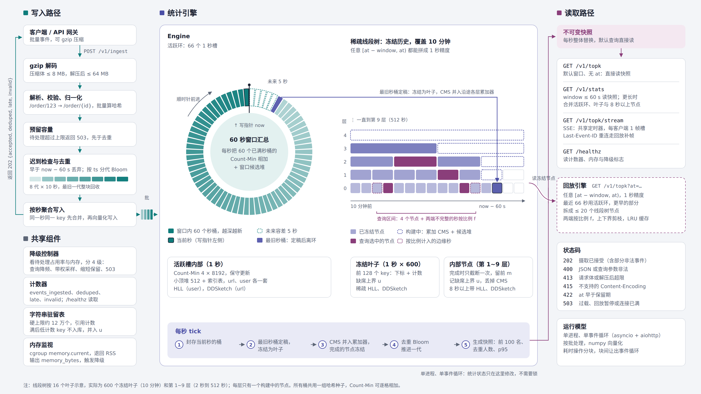

# FlowLens

有界内存的实时流量统计服务：接收 HTTP 访问事件，用固定内存的近似数据结构（Count-Min、HyperLogLog、DDSketch、稀疏线段树）持续维护，随时回答"最近一段时间哪些 URL / 用户最热（Top-K）、去重人数、响应字节 p95"，并支持按历史时刻回放。设计见 [docs/DESIGN.md](docs/DESIGN.md)。



## 快速开始

Docker（推荐，评测环境）：

```bash
docker build -t flowlens .
docker run --rm --memory=256m -p 8080:8080 flowlens
```

默认使用官方 PyPI 拉取依赖；国内网络慢时可加清华镜像源：

```bash
docker build --build-arg PIP_INDEX_URL=https://pypi.tuna.tsinghua.edu.cn/simple -t flowlens .
```

没有 Docker 时用仓库内的 `run.sh`（自建 venv、装依赖、启动，固定 `PYTHONHASHSEED=0`）：

```bash
./run.sh            # 默认监听 :8080，可用 FLOWLENS_PORT / FLOWLENS_HOST 覆盖
```

> 注意：服务要求 `PYTHONHASHSEED` 固定（`run.sh` 与 Dockerfile 已固定为 0）。字符串哈希值随该种子变化，未固定时启动会打印警告。

## 接口一览

| 方法 | 路径 | 用途 |
|---|---|---|
| POST | `/v1/ingest` | 写入一批事件 |
| GET | `/v1/topk` | 区间 Top-K（`by`=url/user，可带 `at` 回放） |
| GET | `/v1/topk/stream` | SSE 实时 Top-K 流（可断线补帧） |
| GET | `/v1/stats` | 区间去重人数与响应字节 p95 |
| GET | `/healthz` | 健康检查与运行状态 |

### 写入事件（POST /v1/ingest）

请求体是**事件数组**（JSON 数组）或 **NDJSON**（每行一条），支持 `Content-Encoding: gzip`，单个请求解压后 ≤ 4 MB。事件字段：`event_id`、`user_id`、`url`、`ts`（epoch 毫秒）、`bytes`。

```bash
curl -X POST http://127.0.0.1:8080/v1/ingest \
  -H "Content-Type: application/json" \
  --data '[{"event_id":"e1","user_id":"u1","url":"/api/item/42","ts":1735689600000,"bytes":128},
           {"event_id":"e2","user_id":"u2","url":"/api/item/43","ts":1735689600123,"bytes":256}]'
```

返回 `202`，各计数按 event_id 去重、迟到/非法剔除：

```json
{"accepted": 2, "deduped": 0, "late": 0, "invalid": 0}
```

> 示例里的 `ts` 是固定的过去时间戳，直接照跑会被判为迟到（`late: 2`）；真实事件用**当前时刻的 epoch 毫秒**作 `ts` 会记入 `accepted`。

### 最近 60 秒 Top-K（GET /v1/topk）

`by` 取 `url` 或 `user`，`k`≤100；不带 `at` 的默认窗口直接读快照，带 `at`（epoch 毫秒）回放历史区间。

```bash
curl "http://127.0.0.1:8080/v1/topk?window=60s&k=10&by=url"
```

返回（`count` 是点估计、`err` 是 [lower, upper] 的半宽度，非采样时为严格保证）：

```json
{
  "window_ms": 60000, "from": 1735689540000, "to": 1735689600000,
  "by": "url", "k": 10, "final": false, "degraded": false, "unseen_upper": 0,
  "items": [
    {"key": "/api/item/{id}", "count": 171133, "err": 0},
    {"key": "/api/home", "count": 88210, "err": 0}
  ]
}
```

### SSE 实时 Top-K 流（GET /v1/topk/stream）

参数同 `/v1/topk`，加 `interval`（帧间隔，默认 1s）；同参数订阅者共用一份计算，断线可按 `Last-Event-ID` 补帧。每帧的 `data` 与 `/v1/topk` 完全同构。

```bash
curl -N "http://127.0.0.1:8080/v1/topk/stream?window=60s&k=10&by=url&interval=1s"
```

```
retry: 3000
id: 1735689600000
event: topk
data: {"window_ms":60000,"from":...,"to":1735689600000,"by":"url","k":10,"final":false,"degraded":false,"unseen_upper":0,"items":[{"key":"/api/item/{id}","count":171133,"err":0},...]}
```

### 区间统计（GET /v1/stats）

去重人数（HyperLogLog）与响应字节 p95（DDSketch），同样支持 `at` 回放；区间内无数据时 `approx_p95_bytes` 为 `null`（不出现 NaN）。

```bash
curl "http://127.0.0.1:8080/v1/stats?window=60s"
```

```json
{
  "window_ms": 60000, "from": 1735689540000, "to": 1735689600000,
  "approx_distinct_users": 4210,
  "approx_p95_bytes": 10240,
  "memory_bytes": 112000000, "degraded": false
}
```

### 健康检查（GET /healthz）

```bash
curl "http://127.0.0.1:8080/healthz"
```

```json
{
  "ok": true, "events_ingested": 1200000,
  "memory_bytes": 112000000, "memory_current_bytes": 168000000, "memory_limit_bytes": 268435456,
  "degraded": false,
  "degrade": {"level": 0, "sample_weight": 1, "occupancy": 0.0,
              "tick_lag_ms": 0.0, "memory_bytes": 112000000, "memory_limit_bytes": 268435456},
  "deduped": 1024, "late": 30, "invalid": 12, "tick_errors": 0, "last_tick_ms": 85.2,
  "malloc_trim": {"enabled": true, "period_sec": 10, "call_count": 60, "total_ms": 180.5,
                  "last_ms": 3.2, "last_freed_mb": 21.4, "total_freed_mb": 1024.8},
  "sse": {"groups": 0, "subscribers": 0, "dropped_frames": 0}
}
```

`memory_bytes` 是工作集（降级判断用它），`memory_current_bytes` 是原始 cgroup 读数，`memory_limit_bytes` 无上限时为 `null`。

## 自测

对正在运行的服务跑边界用例（进程内与远端共用同一套用例定义）：

```bash
python tools/selftest.py --url http://127.0.0.1:8080
```

覆盖 19 个边界用例（空数组、NDJSON、非法 JSON、批内/跨批重复、迟到、未来事件、gzip、解压炸弹、Content-Length 超限、不支持的编码、参数越界、405/404、区间无数据 p95 为 null、SSE 重连等），任一项失败退出码非 0。

单元测试（项目根目录，含 `pyproject.toml`）：

```bash
pip install -e ".[dev]"
pytest -q                 # 快测试（默认跳过 @pytest.mark.slow）
pytest -q -m slow         # 慢测试（等价性对照、打包守护）
```

## 文档索引

- [docs/DESIGN.md](docs/DESIGN.md) — 设计文档（架构、算法、内存预算、性能数据）
- [AI_LOG.md](AI_LOG.md) — AI 使用记录（关键交互、AI 生成的代码、被修正/否决的方案）
- [prototype](docs/prototype/console.html) 项目高保真原型
- [docs/perf/](docs/perf/) — 性能剖析报告（`T11a-report.md`：单核 CPU 上限、事件循环延迟、瓶颈定位）
- [docs/EXPERIMENTS_FORMAT.md](docs/EXPERIMENTS_FORMAT.md) + [tools/experiments.py](tools/experiments.py) — 如何复现实验场景（S1 吞吐 / S2 混合负载 / S3 精度 / S4 攻击 / S5 过载）
- [docs/PROGRESS.md](docs/PROGRESS.md) — 进度交接单（已定决策、未解决问题、基准数据）
- [docs/research/初期调研.md](docs/research/初期调研.md) — 提交前的独立算法调研（HyperLogLog / HyperLogLog++ 等）

## 已知限制

单进程、单核运行（所有统计状态归一个事件循环的单个写者，不加锁、不多进程分片；性能靠按批处理 + numpy 向量化）。实测可持续吞吐与 20 万条/秒目标仍有差距，实测数字与差距分析见设计文档第 7、8 节。
