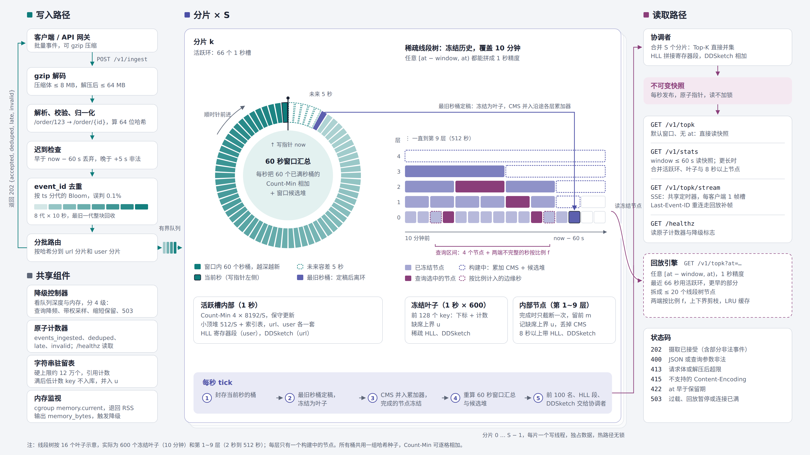

# FlowLens 设计文档

## 1. 概述

FlowLens 挂在 API 网关旁边，在 256 MB 内存里实时回答：最近一段时间哪些 URL、哪些用户最热，有多少个不同的用户，响应大小的 p95 是多少。

事件太多存不下，我们只存摘要：Count-Min Sketch 估次数，小顶堆记热点名单，HyperLogLog 估去重人数，DDSketch 估分位数。这几种摘要两份可以直接合成一份，所以把时间切成 1 秒一格，每格一份摘要，查某段时间就把对应的格子合起来。滑动窗口、`at` 回放、多核并行都建立在这一点上。

 <em>图 1　全组件架构</em>

左边是写入：解码、校验、迟到检查、去重，再按 key 分给各分片。中间是一个分片：最近 66 秒放在环里，更早的冻结后放进稀疏线段树，保留 10 分钟。右边是读取：默认查询读每秒生成的快照，带 `at` 的查询由回放引擎现场合并。

## 2. 题目留白处的约定

| 问题 | 约定 | 原因 |
|---|---|---|
| 按什么时间统计 | 事件自带的 `ts` | 同一段时间无论何时查结果都一样，回放才有意义 |
| 查询区间 | `[at − window, at)`，精确到毫秒；默认 `at` 为当前时间取整到秒 | 相邻窗口不重不漏；当前这一秒还没结束 |
| 迟到与未来 | `ts` 早于 now − 60 s 丢弃（`late`），晚于 now + 5 s 视为非法（`invalid`）；`at` 在最近 60 秒内时结果标 `final: false` | 题目允许迟到不超过一个窗口；分界线用服务器时钟算，免得一条错乱的 `ts` 把它推歪；5 秒留给时钟偏差。见图 2 |
| 重试 | 只看 `event_id`，假设重试时 `ts` 不变 | 去重只需覆盖一小段 `ts` |
| URL 归一化 | 去掉 query 和 `#` 之后；纯数字、UUID、长十六进制路径段换成 `{id}`；最长 128 字节 | `/order/123` 和 `/order/456` 是同一个接口 |
| 并列 | 次数多的在前，相同按 key 字典序 | 结果稳定 |
| 保留期 | 10 分钟，`window` 最长 600 s | 由内存预算决定 |

 <em>图 2　迟到处理与去重分代</em>

## 3. 各模块怎么做

### 3.1 写入与去重

handler 依次做：gzip 解码（压缩后超 8 MB 或解压后超 64 MB 返回 413）；解析校验、URL 归一化、对 key 算一次 64 位哈希（后面各处都从它取位）；迟到检查；`event_id` 去重；按分片分批放进有界队列。做完就返回 202 和 `{accepted, deduped, late, invalid}`，不等后面的统计。

精确记住所有 `event_id` 要几百 MB，所以用 Bloom filter，每个 id 约 14 位，代价是约 0.1% 的新事件被误认成重复。Bloom filter 不能删元素，所以按 `ts` 每 10 秒分一代，保留 8 代（图 2 最下面一行），整代过了 watermark 就清空复用，共约 29 MB。查重和写入按 `event_id` 哈希分段加锁，防止并发的同一个 id 都被当成新事件。

### 3.2 分片

分片数等于 CPU 核数，每个分片由一个线程独占，统计时不用加锁。url 按 `hash(url)` 分，user 按 `hash(user)` 分，同一个 key 只在一个分片里，各分片的名单合起来就是全局结果。每个分片的 Count-Min 宽度和堆容量取全局值的 1/S，总内存和误差不随分片数变化。HLL 用用户哈希的同一段前缀同时选分片和寄存器，各分片写各自那段，拼起来就是完整的 HLL。

### 3.3 最近 66 秒：活跃环

每个分片有一个 66 格的环：60 格是窗口，1 格是当前秒，5 格留给时钟偏差带来的"未来"事件。写指针每秒前进一格，最旧的一格定稿后离开。每格存 url 和 user 各一套 Count-Min（4 × 8192，保守更新）和小顶堆（512 个位置，带索引表），另有 HLL 寄存器段和 DDSketch。

每条事件先写 Count-Min 拿到估计次数。key 在堆里就加一；不在堆里但超过堆顶，就替换堆顶。已在堆里的 key 也写 Count-Min，这样被挤出后再回来，次数不会丢。

后面常用到一个性质：一秒结束时不在堆里的 key，这一秒的真实次数不超过堆顶。因为它每次出现时都没超过当时的堆顶，被挤出时次数等于当时的堆顶，而堆顶只增不减。我们把它叫缺席上界 u。

为了不漏掉"每秒都不热、一分钟加起来很热"的 key，每个分片为默认窗口另外维护一个候选堆，用"上一秒的窗口汇总 + 当前秒"的估计值筛选。

### 3.4 更早的数据：稀疏线段树

`at` 精确到毫秒，`window` 可以任意填，评测会和离线精确结果对比。历史如果只按 10 秒对齐，60 秒窗口最多有六分之一落在错误区间，所以历史也要 1 秒精度。但 600 个完整秒桶要两三百 MB，我们只让环里的 66 格保持完整，更早的只留必要信息。

秒桶离开环后变成叶子，只留前 128 个 key 的次数、u、稀疏的 HLL 和 DDSketch。叶子之上是第 1 到第 9 层，第 k 层每个节点覆盖 2^k 秒。每层同一时刻只有一个节点在构建，带一个累加用的 Count-Min 和候选堆；每个秒桶定稿时，把它的 Count-Min 加进所有正在构建的祖先节点。节点完成时按估计值留下前 m 个，记下 u，扔掉 Count-Min，变成只读数组。

这样每个节点只截断一次，误差不会像普通线段树那样逐层叠加（图 3）。能做到这一点，是因为每秒的数据离开环之前 Count-Min 都还在。8 秒以上的节点才带 HLL 和 DDSketch。

 <em>图 3　为什么每个节点只截断一次</em>

字符串表有硬上限（约 12 万个）。冻结时次数不超过 u 的条目直接丢掉，表满后新 key 不再入库、次数算进 u。这样无论流量长什么样内存都有上限，随机 URL 的攻击流量会让节点自然变空。

### 3.5 快照与查询

每秒每个分片：封存当前秒；最旧秒桶冻结成叶子，并入各层累加器，冻结完成的节点；把环里 60 秒的 Count-Min 相加，重建窗口汇总；取前 100 名连同 HLL 段和 DDSketch 交给协调者。协调者合并后生成只读快照，用原子指针替换，读请求不加锁。每秒重建而不做增量加减，迟到事件下一秒自然算进去。

默认的 `/v1/topk` 直接读快照。带 `at` 或其他 `window` 的走回放引擎（图 4）：最近 66 秒用环里的秒桶，更早的拆成最多约 20 个线段树节点，两端不满一秒的按覆盖比例 f 折算。然后给每个候选算出次数的上下界，用第 K 大的下界当门槛，上界够不着的直接淘汰，只精算剩下的。定型区间的结果进 LRU 缓存，回放最多同时跑 4 个。

 <em>图 4　回放查询：区间怎么拆、候选怎么剪</em>

`/v1/stats` 在 `window` 超过 60 秒时合并环、叶子和 8 秒以上节点；HLL 不能按比例拆，边缘秒覆盖过半才算进去。所有结果都带 `count`、`err` 和实际使用的 `from`、`to`。

SSE 订阅者按参数共用定时器和结果；重连时按 `Last-Event-ID` 用回放补发最多 30 帧；每个客户端只留最新一帧，读得慢就跳帧。

### 3.6 过载与降级

handler 只往队列里放，不等统计，调用方不会被拖住。负载上来时依次降级，每级有进入和退出两个阈值，状态体现在 `/healthz` 的 `degraded`：

| 级别 | 触发 | 动作 |
|---|---|---|
| 1 | 队列 > 60% 或处理延迟 > 1 s | SSE 降频，快照缓存变长，暂停回放（503） |
| 2 | 队列 > 80% | Top-K 和 DDSketch 按概率 p 采样、每条按 1/p 计；HLL 和去重照常 |
| 3 | 内存 > 200 MB | 缩短历史保留，收紧并发 |
| 4 | 内存 > 230 MB | 写入返回 503 + Retry-After |

第 4 级不等于丢数据，去重保证重试不会重复计数；真正丢数据的，是硬撑到内存超限被容器杀掉。

## 4. 复杂度与误差

写入每条 O(L + d + log m)，L 为 key 长度、d = 4；默认查询 O(K)；回放最多合并约 20 个节点加环内秒桶。

| 统计项 | 误差 |
|---|---|
| 环内单秒的 Top-K 次数 | Count-Min 只高估，每秒不超过 e·N/w ≈ 66，概率 ≥ 98% |
| 60 秒窗口 | 约 4000，结果里带 `err` |
| 冻结节点、边缘秒 | 不在名单的 key ≤ u；边缘秒为 `[0, 整秒次数]`，都一定成立 |
| 去重用户数 | HLL p = 14，标准误差 0.81% |
| p95 | DDSketch α = 1%，相对误差 ≤ 1%，一定成立 |
| `event_id` 去重 | 约 0.1% 的新事件被误丢 |

## 5. 内存预算

按最坏情况（所有 URL 和用户互不相同）估算：活跃环约 23 MB，线段树约 25 MB，字符串表上限 20 MB，去重 Bloom 29 MB，写入缓冲 30 MB，查询临时内存、缓存和快照约 23 MB，合计约 150 MB。常驻数据控制在 256 MB 的六成左右，其余留给运行时。`memory_bytes` 读 cgroup 的 `memory.current`，读不到用 RSS。

## 6. HTTP 语义

写入成功返回 202（空数组、部分事件非法也是 202）；参数不合法 400（`k` 1~100，`window` 1~600 s）；`at` 早于保留期 422；方法不对 405；超大 413；不支持的编码 415；过载、回放暂停、连接满 503 + `Retry-After`。

## 7. 测试

离线精确程序读同一份数据，和服务对比召回率、次数误差、HLL 和 p95 误差。自测脚本覆盖 14 个边界用例，如重复 `event_id`、`ts` 正好在 watermark 上、区间起止边界、损坏的 gzip、`at` 带毫秒、SSE 重连、过载进入和恢复。线段树另外测：随机区间拆出的节点不重不漏；真实次数必须落在返回的上下界内。另用 `docker run --memory=256m` 跑全随机流量验证内存有界，并压测吞吐和 p99。

待补的实验：长尾和接近均匀两种流量下的 Top-10 召回率与次数误差，随机流量攻击下的峰值内存，吞吐瓶颈在哪。

## 8. 主要取舍

用近似换内存，误差都有上限并随结果报出。迟到上限等于窗口，去重和活跃环才能限定在 70 秒左右，这是内存可控的前提。稀疏线段树换来任意区间 1 秒精度的回放，代价是实现和测试更复杂。默认查询最多晚 1 秒，换来不加锁的读取。过载时先降精度后拒绝，因为去重让重试是安全的。

## 9. 规划中：节点退出与历史落盘

主功能完成后实现。节点区间整体早于 now − 600 s 时标记为已废弃，新查询不再选它，正在读的查询读完后才释放。释放前可选择把节点写进日志（默认关闭，只写 64 秒节点，每天约 25 MB），用于离线分析和重启恢复，磁盘慢就放弃，不影响写入。开启落盘时 `memory_bytes` 只统计匿名内存，因为 cgroup 会把页缓存也算进去。
