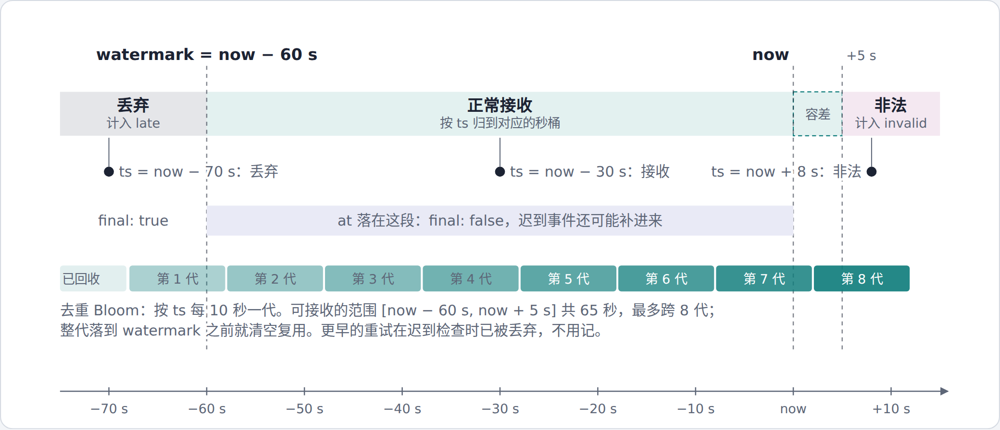
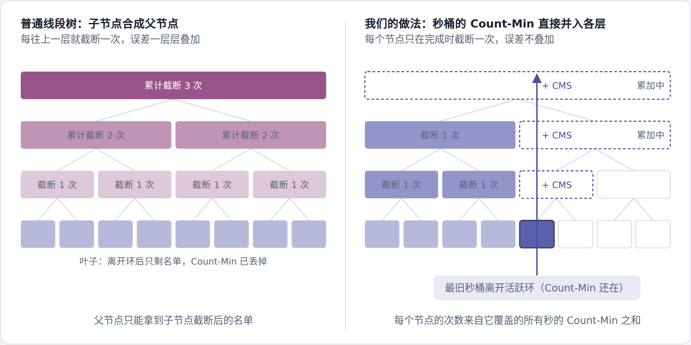
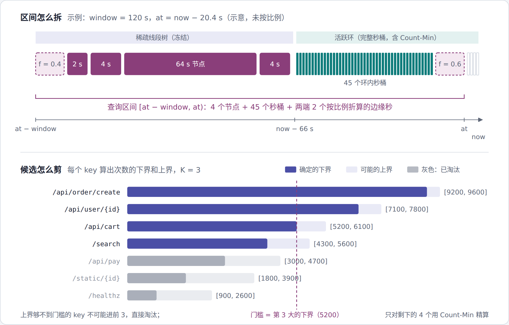

# FlowLens 设计文档

## 1. 概述

FlowLens 挂在 API 网关旁边，在 256 MB 内存里实时回答：最近一段时间哪些 URL、哪些用户最热，有多少个不同的用户，响应字节数的 p95 是多少。

事件太多存不下，只存摘要：Count-Min Sketch 估次数，小顶堆记热点名单，HyperLogLog 估去重人数，DDSketch 估分位数。这几种摘要两份可以直接合成一份，所以把时间切成 1 秒一格，每格一份摘要，查某段时间就把对应的格子合起来。滑动窗口、`at` 回放都建立在这一点上。全部摘要结构自行实现，未使用现成的近似统计库。

服务用 Python 实现，单进程、单事件循环（asyncio + aiohttp），性能靠按批处理与 numpy 向量化获得。

 <em>图 1　全组件架构</em>

左边是写入：解码、校验、按字节预留容量、迟到检查、去重，再按秒聚合写入。中间是统计引擎：最近 66 秒放在环里，更早的冻结后放进稀疏线段树，可查约 10 分钟。右边是读取：默认查询读每秒生成的快照，带 `at` 的查询由回放引擎现场合并。

## 2. 题目留白处的约定

| 问题 | 约定 | 原因 |
|---|---|---|
| 请求体 | JSON 数组或 NDJSON（每行一条），均可 gzip | 题目 1.1 写 NDJSON、1.2 写数组，两种都接受 |
| 按什么时间统计 | 事件自带的 `ts` | 同一段时间无论何时查，结果都一样，回放才有意义 |
| 查询区间 | `[at − window, at)`，精确到毫秒；默认 `at` 为当前时间取整到秒 | 相邻窗口不重不漏；当前这一秒还没结束 |
| 迟到与未来 | `ts` 早于 now − 60 s 丢弃（`late`）；晚于 now + 5 s 视为非法（`invalid`）；区间未定稿时结果标 `final: false` | 题目允许迟到不超过一个窗口；分界线用服务器时钟，免得一条错乱的 `ts` 把它推歪；5 秒留给时钟偏差。见图 2 |
| 重试 | 只看 `event_id`，假设重试时 `ts` 不变 | 去重只需覆盖一小段 `ts` |
| URL 归一化 | 去掉 scheme、主机、query、`#`；纯数字、UUID、16 位以上十六进制的路径段换成 `{id}`；最长 128 字节 | `/order/123` 与 `/order/456` 是同一个接口 |
| 并列 | 次数多的在前，相同按 key 字典序 | 结果稳定 |
| 可查范围 | 最新定稿秒（约 now − 60 s）往前 10 分钟；`window` 1～600 s；更早返回 422 | 由内存预算决定 |

 <em>图 2　迟到处理与去重分代</em>

## 3. 各模块怎么做

### 3.1 写入与去重

写入依次做：gzip 解码（请求体与解压后都不超过 4 MB，否则 413）；按解压后字节数预留在途额度（合计 4 MB，满了返回 503 + `Retry-After`）；解析与逐条校验、URL 归一化、批量算 64 位哈希；迟到检查；`event_id` 去重；同一秒同一 key 先合并，再写入秒桶。返回 202 与 `{accepted, deduped, late, invalid}`，单条不合法只计入 `invalid`，不影响同批其他事件。

**预留必须在解析与去重之前。** 先去重再拒绝，这些 `event_id` 已经写进 Bloom，调用方重试时会被当成重复而丢掉；先解析再预留，又挡不住解析本身的内存（实测 orjson 解析出的对象约为原始 JSON 的 3.4 倍）。读取请求体另有 8 MB 的原始字节额度；带 `Expect: 100-continue` 的大请求在发送请求体之前就会被拒。处理按 5000 条一块进行，块与块之间让出事件循环。

精确记住所有 `event_id` 要几百 MB，所以用 Bloom filter。它不能删元素，所以按 `ts` 每 10 秒分一代、保留 8 代（图 2 下排），整代过了 watermark 就清空复用。每代按 200 万条、误判 0.1% 设计，位数取到 2 的幂，实际误判约 0.03%，共 32 MiB。

### 3.2 单进程、单写者

Python 有全局解释器锁，多线程用不上多核；每个 Python 进程又有几十 MB 的基础内存，256 MB 里开不了几个。所以只跑一个进程、一个事件循环，全部统计状态归一个引擎对象，只在事件循环里修改，不需要锁，也不存在数据竞争。名单已满时，先向量化筛掉不可能入选的 key，只对剩下的少数逐个更新堆。

### 3.3 最近 66 秒：活跃环

66 格的环：60 格是窗口，1 格是当前秒，5 格留给"未来"事件。每格存 url 与 user 各一套 Count-Min（4 × 8192，保守更新）与小顶堆（512 个位置，带索引表），另有 HLL（user）与 DDSketch（url）。

每条事件先写 Count-Min 拿到估计次数：key 在堆里就加上；不在堆里但超过堆顶就替换堆顶。已在堆里的 key 也写 Count-Min，被挤出后再回来，次数不会丢。由此有一个关键性质：一秒结束时不在堆里的 key，这一秒的真实次数不超过堆顶，因为它每次出现时都没超过当时的堆顶，而堆顶只增不减。我们把它叫缺席上界 u。

### 3.4 更早的数据：稀疏线段树

`at` 精确到毫秒、`window` 任意，评测会和离线精确结果对比。历史如果只按 10 秒对齐，60 秒窗口最多有六分之一落错区间，所以历史也要 1 秒精度。但 600 个完整秒桶要两三百 MB，于是只让环里的 66 格保持完整。

秒桶离开环后变成叶子，只留前 128 个 key 的次数、u、HLL 与 DDSketch。叶子之上是第 1～9 层，第 k 层每个节点覆盖 2^k 秒。每层同一时刻只有一个节点在构建，带一个累加用的 Count-Min 与候选堆；秒桶定稿时，把它的 Count-Min 加进所有正在构建的祖先。节点完成时按估计值留下前 m 个、记下 u、扔掉 Count-Min。这样每个节点只截断一次，误差不会逐层叠加（图 3），因为每秒的数据离开环之前 Count-Min 都还在。冻结时次数不超过 u 的条目直接丢掉，全随机的攻击流量会让节点名单自然变空（实测约 0.4 MB）。

 <em>图 3　为什么每个节点只截断一次</em>

### 3.5 快照与查询

每秒的 tick 先定稿（最旧秒桶冻结成叶子，并入各层累加器），推进 Bloom 的代，再合并最近 60 个整秒生成快照（前 100 名、去重人数、p95），整体替换。快照按维度分段计算，段间让出事件循环。每秒重建而不做增量加减，迟到事件下一秒自然计入。快照、回放、SSE 都调用同一个组装时间片的方法，结果一致。

默认的 `/v1/topk` 与 `/v1/stats` 直接读快照。带 `at` 或其他 `window` 的走回放（图 4）：最近 66 秒用环里的秒桶，更早的拆成最多约 20 个线段树节点，两端不满一秒的按覆盖比例 f 折算。合并时每个 key 得到次数的上下界，按点估计选出前 K 个，只对它们用 Count-Min 收紧上界；上界够不到第 K 大下界的候选不可能进前 K，所以其余候选不必精算。从未进入任何一秒名单的 key 不会出现在结果里，但它的次数一定不超过响应中的 `unseen_upper`。定稿区间的结果进 LRU 缓存。

 <em>图 4　回放查询：区间怎么拆、为什么只需精算前 K 个</em>

SSE 按参数分组，同组订阅者共用一份计算，每组每秒最多重算一次，最多 8 组、256 个订阅者。每个订阅者只保留最新一帧（慢客户端跳帧，5 秒写不出去就断开）；每组缓存最近 30 帧，重连时按 `Last-Event-ID` 从缓存补发，id 连续递增。

### 3.6 过载与降级

不丢摄取的原则：所有拒绝都发生在去重之前，并返回 503 + `Retry-After`，调用方重试是安全的；一旦接受就完整计入。负载上来时依次降级，每级有进入与退出两个阈值（滞回），状态见 `/healthz` 的 `degraded`。内存指 cgroup 工作集（`memory.current` 减去不活跃的页缓存，与 `docker stats` 口径一致）：

| 级别 | 进入条件 | 动作 |
|---|---|---|
| 1 | 在途字节 > 60% 或 tick 延迟 > 1 s | 回放查询暂停（503），SSE 每 5 秒重算一次；默认查询照常 |
| 2 | 在途字节 > 80% | Top-K 与 p95 按 `event_id` 哈希确定性采样（1/2 或 1/4），按权重计入；HLL 与去重全量；响应带 `sample_rate`，此时上下界为近似 |
| 3 | 内存 > 上限 × 78% | 在途与原始字节额度减半，拒绝新的 SSE 订阅，清空缓存 |
| 4 | 内存 > 上限 × 90% | 写入在读取请求体之前返回 503 |

## 4. 复杂度与误差

写入每条 O(L + d)（L 为 key 长度，d = 4），名单更新只发生在筛选后的少数 key 上，每个 O(log m)；默认查询 O(K)；回放最多合并约 20 个节点加环内秒桶。

| 统计项 | 误差上界（理论） | 实测（长尾，§7） |
|---|---|---|
| Top-K 次数 | Count-Min 只高估；不在名单的 key ≤ u；结果带 `err`，真实值一定在 [下界, 上界] 内 | 计数误差 0.05%～0.09%，100% 落在上下界内 |
| 去重用户数 | HLL p = 14，标准误差 0.81% | 0.92% |
| p95 | DDSketch α = 1%，相对误差 ≤ 1% | 0.14% |
| `event_id` 去重 | 误判约 0.03% | — |

## 5. 内存

服务的数据结构有界：固定部分（Bloom 32 MiB、活跃环 Count-Min 16.5 MiB、线段树各节点的 HLL 约 12 MiB）启动即分配；随数据增长的部分（名单、字符串、缓存）在 10 分钟保留期填满后封顶，进程内实测约 100 MB，长尾与全随机流量几乎相同。字符串经驻留表共享（user 8192 项、URL 32768 项，满则清空），各缓存都有上限。

容器实测发现，工作集比数据结构本身多出约 100 MiB：一半是 glibc 留着不还的已释放内存（每个请求解析出上万个临时对象），一半是并发请求的解析与连接缓冲。对策是每 10 秒调用 `malloc_trim`，并把 glibc 的大块分配阈值固定为 128 KB（`MALLOC_MMAP_THRESHOLD_`），让请求体与临时数组用完立即归还。修正后同样负载下峰值从 237 MiB 降到 179 MiB（下表）。

| 场景（256 MB 容器，32 个并发连接） | 工作集峰值 | 降级 |
|---|---|---|
| 空载 | 约 70～80 MiB | 0 级 |
| 长尾，每秒 3 万条，5 分钟 | 179 MiB | 全程 0 级，接受率 100% |
| 全随机攻击流量，每秒 3 万条，10 分钟 | 【F1】 | 【F1】 |

## 6. HTTP 语义

写入成功 202（含空数组、部分事件非法）；JSON 或参数不合法 400（`k` 1～100，`window` 1～600 s）；路径不存在 404；方法不对 405；请求体超限 413；编码不支持 415；`at` 早于可查范围 422；过载、回放暂停或连接已满 503 + `Retry-After`。错误统一返回 `{"error": ...}`，没有数据时数值字段为 `null`。超限请求的 413 立即发出，服务端再用 1 秒读完在途请求体后关闭连接，避免客户端收到 RST。`docker stop` 时收到 SIGTERM 即正常退出。

## 7. 测试与实验

单元与集成测试 300 余个，在镜像的 Python 3.12 中运行；`tools/selftest.py` 对运行中的服务检查 18 个边界用例（空数组、非法 JSON、部分非法、批内与跨批重复、迟到、未来、gzip、解压炸弹、超大请求、不支持的编码、早于保留期、参数越界、405、404、无数据时为 null、SSE 重连、NDJSON 等）。线段树的性质测试检查随机区间拆分不重不漏、真实次数落在上下界内，并做过变异检验。

实验用 `tools/loadgen.py` 产生流量并存档，`tools/exact.py` 对任意区间算精确答案。压测流量中约一半的 URL 路径带每次都不同的随机 ID，是偏严苛的设定。全部在 `docker run --memory=256m` 中进行，服务固定在一个 CPU 核上：

| 场景 | 结果 |
|---|---|
| 精度（长尾，每秒 3 万条，5 分钟，抽样 200 个区间） | 召回 100%，计数误差 0.05%～0.09%，100% 落在上下界内；去重 0.92%，p95 0.14% |
| 最大可持续吞吐（单核） | 【F1】 |
| 混合负载下查询 p99（默认 / 回放 / stats） | 【F1】 |
| 过载与恢复 | 【F1】 |

## 8. 主要取舍

**用近似换内存**，误差有上限并随结果报出。迟到上限等于窗口，去重与活跃环才能限定在 70 秒左右，这是内存可控的前提。稀疏线段树换来任意区间 1 秒精度的回放，代价是实现与测试更复杂。

**吞吐未达到 20 万条/秒。** 选 Python 换来代码好读、每处设计讲得清，代价是单核吞吐有限。剖析显示每条事件约 12 μs，其中约 60% 在逐条校验与 URL 归一化（带随机 ID 的路径无法命中归一化缓存），引擎写入约 22%，JSON 解析约 5%。我们没有用多进程去凑这个数字：256 MB 里每多一个 Python 进程就多占几十 MB，会把内存这一项赔进去。已实施归一化与校验的快路径【F1：优化后的结果】；后续方向是把写入分块缩小以降低查询延迟、垃圾回收调优、快照改为增量维护。

**过载时先让路、再采样、最后拒绝**，因为拒绝发生在去重之前，重试是安全的。

## 9. 后续规划

节点超出保留期后可选写入日志（默认关闭），用于离线分析与重启恢复。服务提供只读的调试接口 `/debug/structure`（设置 `FLOWLENS_DEBUG=1` 时开启），输出环与线段树的状态，便于观察与可视化。
