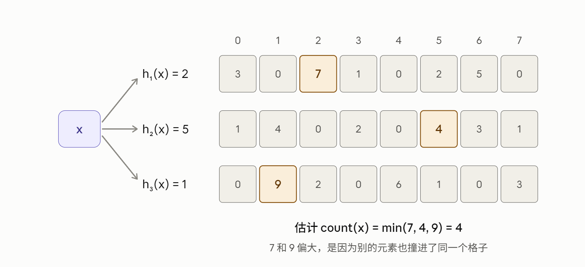

## 相关算法

### HyperLogLog

> 参考文献： Philippe Flajolet, Éric Fusy, Olivier Gandouet, Frédéric Meunier. *HyperLogLog: the analysis of a near-optimal cardinality estimation algorithm.* AofA 2007（Conference on Analysis of Algorithms） 

#### 问题

一个当下经典的基于概率的流式算法，用于解决数据流算法中的**基数估计**问题（集合中有几个不同的元素）。

它的核心直觉来自抛硬币。假设你不停地抛硬币，记录"连续出现几次反面才第一次出现正面"

HyperLogLog使用调和平均计算桶的估计值，因此相比前身 LogLog 算法精度更高。

#### 关键概率规律

ρ表示一个二进制串中从左往右数，第一个 1 出现在第几位。

之所以要统计这个值，是因为哈希后的每一位可以看作独立的随机比特，0 和 1 各占一半概率。于是 ρ(w) = 1 的概率是 1/2（第一位是 1），ρ(w) = 2 的概率是 1/4（第一位是 0、第二位是 1），ρ(w) = 3 的概率是 1/8，一般地，ρ(w) = k 的概率是 2^(-k)。这就和抛硬币直到第一次出现正面所用的次数完全一样。

算法名字中的 “LogLog” 也和 ρ 有关。对于 n 个元素，最大的 ρ 大约是 log₂n，而存储这个数只需要 log₂(log₂n) 个比特

算法用哈希值的前b位把元素分到m个桶里，每个桶各自记录自己的最大 ρ，就能粗略推断出不同元素的数量约为 2^ρ

#### 相关参数

b 决定寄存器（桶） 2^b，m 越大，估计越精确（标准误差约为 1.04/√m）

αm 是修正常数，用于消除估计量的系统性偏差。常用取值，α_16 = 0.673，α_32 = 0.697，α_64 = 0.709。

α_m 的积分表达式：α_m = ( m × ∫₀^∞ ( log₂((2+u)/(1+u)) )^m du )^(-1)

近似公式 α_m ≈ 0.7213 / (1 + 1.079/m)。随着 m 增大，α_m 逐渐趋近于极限值 1/(2 ln 2) ≈ 0.72135

#### 核心伪代码

```txt
# HyperLogLog算法核心伪代码
Require: Let h : D → {0,1}^32 hash data from domain D.
    Let m = 2^p with p ∈ [4..16].
Phase 0: Initialization.
    Define α_16 = 0.673, α_32 = 0.697, α_64 = 0.709,
        α_m = 0.7213/(1 + 1.079/m) for m ≥ 128.
    Initialize m registers M[0] to M[m − 1] to 0.
Phase 1: Aggregation.
    for all v ∈ S do
        x := h(v)
        idx := ⟨x_31, ..., x_(32−p)⟩_2        { First p bits of x }
        w := ⟨x_(31−p), ..., x_0⟩_2
        M[idx] := max{M[idx], ρ(w)}
    end for
Phase 2: Result computation.
    E := α_m m^2 · ( Σ_{j=0}^{m−1} 2^(−M[j]) )^(−1)        { The "raw" estimate }
    if E ≤ (5/2)m then
    	# 小范围修正：若估计值小于2.5*m 大小，调和平均估计偏差较大
        Let V be the number of registers equal to 0.
        if V ≠ 0 then
        	# 如果有空的桶，说明基数小HLL估计数值偏高，则回退到线性计数
            E* := LinearCounting(m, V) # 估计公式n = m*ln(m/V)，m桶的数量，V空桶数量
        else
            E* := E
        end if
    else if E ≤ (1/30)2^32 then           {1/30 表示修正的幅度，将估计值限制在1.43 亿以下}
        E* := E
    else
    	# 大范围修正：若估计值大于2^32，哈希值只有 32 位（约 43 亿）种不同取值，当不同元素数量接近这个   		 规模时，两个不同的元素很可能哈希成同一个值，导致低估。
		  某个格子在 n 个元素之后仍然空着的概率是 (1 − 1/N)^n ≈ e^(−n/N)，空格子的比例
          反推得到n = −N × log(1 − E/N)，这里N= 2^32表示格子数
        E* := −2^32 log(1 − E/2^32)
    end if
    return E*

Define LinearCounting(m, V)
    Returns the LinearCounting cardinality estimate.
    return m log(m/V)                      { E = m × ln(m / V), V表示空桶个数 }
```

### HyperLogLog++

> 参考文献：Stefan Heule, Marc Nunkesser, Alexander Hall. *HyperLogLog in Practice: Algorithmic Engineering of a State of The Art Cardinality Estimation Algorithm.* EDBT 2013

核心的分桶、求最大 ρ、调和平均都没有变，改进集中在三个方面：用64位哈希、对偏差做经验修正、在基数小时用稀疏表示。

* **64位哈希**

​	把哈希函数从32位换成64位，放大以后防止了哈希碰撞的发生。由于ρ(w)存储loglog的特性，从32 —> 64寄存器 仅需要增加一个bit位，从5—>6。内存从 5 × 16384 = 81920 位（10 KB）变成 6 × 16384 = 98304 位（12 KB），只多了 2 KB。可以直接去掉大范围修正。

* **偏差经验修正**

​	针对"估计值偏高 25%"的问题，作者通过模拟发现，在基数较小时的误差主要来自系统性偏差，而且同一基数下多次实验的结果非常集中。偏差是稳定可预测的，就可以提前测出来再减掉。具体做法是，对每个精度 p，在每个基数下用 5000 个随机数据集跑原始估计，记录平均估计值和偏差，选 200 个点做成查找表。实际运行时，用原始估计 E 去查表，取最近的 6 个点插值得到偏差，再从 E 中减去。这个修正只在 E ≤ 5m 时使用，超过 5m 后偏差已经可以忽略。原版在n=2.5m= 40960 处有一个明显的误差尖峰，这个切换点不理想。

* **稀疏表示**

​	原版无论数据多少，都要固定分配m个寄存器占用6m内存。但实际数据中存在长尾分布，99% 的去重计数结果都不超过 100，这时绝大多数寄存器都是空的。稀疏表示只存储真正被写入过的寄存器，用 (idx, ρ(w)) 这样的键值对表示。当键值对占用的空间超过 6m 位时，再转换回普通的寄存器数组。为了让插入高效，新元素先放进一个无序的临时集合，攒到一定数量再排序后与主列表合并，同一个 idx 只保留最大的 ρ。

​	由于稀疏表示只存非空的桶，桶的总数越多只增加每条记录里编号的位数。所以在稀疏阶段，可以改用更高的精度 p'（"取哈希值的前几位作为桶编号"）。论文中取 p' = 25，相当于有 2^25 ≈ 3355 万个桶，，而每条记录只需 25 + 6（”用来存ρ，6 个比特能表示 0 到 63，远大于桶数2^25“） = 31 位，加 1 个标志位（"用来记录有没有存ρ"）正好装进一个 32 位整数。

​	一个元素64位进来，前25位决定进哪个桶，剩下 39 位里第一个 1 出现在第几位（也就是 ρ）。按照当前设置，仅使用了25+6位的信息。

#### 核心伪代码

```txt
HyperLogLog++ 算法核心伪代码
Input: The input data set S, the precision p, the precision
    p' used in the sparse representation where p ∈ [4..p'] and
    p' ≤ 64. Let h : D → {0,1}^64 hash data from domain D
    to 64 bit values.
Phase 0: Initialization.
    m := 2^p; m' := 2^p'
    α_16 := 0.673; α_32 := 0.697; α_64 := 0.709
    α_m := 0.7213/(1 + 1.079/m) for m ≥ 128
    format := SPARSE
    tmp_set := ∅
    sparse_list := []
Phase 1: Aggregation.
    for all v ∈ S do
        x := h(v)
        switch format do
        	# 
            case NORMAL
                idx := ⟨x_63, ..., x_(64−p)⟩_2
                w := ⟨x_(63−p), ..., x_0⟩_2
                M[idx] := max{M[idx], ρ(w)}
            end case
            case SPARSE
                k := EncodeHash(x, p, p')
                tmp_set := tmp_set ∪ {k}
                if tmp_set is too large then
                    sparse_list :=
                        Merge(sparse_list, Sort(tmp_set))
                    tmp_set := ∅
                    # 在这里判断是否切换回普通的寄存器数组，m是寄存器的个数m = 2^14 = 16384
                    # 盈亏平衡点大约是 6m ÷ 25 ≈ m/4 ≈ 4000 个元素
                    if |sparse_list| > m · 6 bits then
                        format := NORMAL
                        M := ToNormal(sparse_list)
                    end if
                end if
            end case
        end switch
    end for
Phase 2: Result computation.
    switch format do
        case SPARSE
            sparse_list := Merge(sparse_list, Sort(tmp_set))
            return LinearCounting(m', m' − |sparse_list|)
        end case
        case NORMAL
            E := α_m m^2 · ( Σ_{j=0}^{m−1} 2^(−M[j]) )^(−1)
            E' := (E ≤ 5m) ? (E − EstimateBias(E, p)) : E
            Let V be the number of registers equal to 0.
            if V ≠ 0 then
                H := LinearCounting(m, V)
            else
                H := E'
            end if
            if H ≤ Threshold(p) then
                return H
            else
                return E'
            end if
        end case
    end switch
```

**辅助代码**

```txt
Define LinearCounting(m, V)
    Returns the LinearCounting cardinality estimate.
    return m log(m/V)

Define Threshold(p)
    Returns empirically determined threshold (we provide
    the values from our implementation at http://goo.gl/iU8Ig).

Define EstimateBias(E, p)
    Returns the estimated bias, based on the interpolating
    with the empirically determined values.

Define EncodeHash(x, p, p')
    Encodes the hash code x as an integer.
    if ⟨x_(63−p), ..., x_(64−p')⟩ = 0 then
        return ⟨x_63, ..., x_(64−p')⟩ || ⟨ρ(⟨x_(63−p'), ..., x_0⟩)⟩ || ⟨1⟩
    else
        return ⟨x_63, ..., x_(64−p')⟩ || ⟨0⟩
    end if

Define GetIndex(k, p)
    Returns the index with precision p stored in k
    if ⟨k_0⟩ = 1 then
        return ⟨k_(p+6), ..., k_6⟩
    else
        return ⟨k_(p+1), ..., k_1⟩
    end if

Define DecodeHash(k, p, p')
    Returns the index and ρ(w) with precision p stored in k
    if ⟨k_0⟩ = 1 then
        r := ⟨k_6, ..., k_1⟩ + (p' − p)
    else
        r := ρ(⟨k_(p'−p−1), ..., k_1⟩)
    end if
    return (GetIndex(k, p), r)

Define ToNormal(sparse_list, p, p')
    Converts the sparse representation to the normal one
    M := NewArray(m)
    for all k ∈ DecodeSparse(sparse_list) do
        (idx, r) := DecodeHash(k, p, p')
        M[idx] := max{M[idx], ρ(w)}
    end for
    return M

Define Merge(a, b)
    Expects two sorted lists a and b, where the first is
    compressed using a variable length and difference encoding.
    Returns a list that is sorted and compressed in the same
    way as a, and contains all elements from a and b, except
    for entries where another element with the same index,
    but higher ρ(w) value exists. This can be implemented
    in a single linear pass over both lists.

Define DecodeSparse(a)
    Expects a sorted list that is compressed using a variable
    length and difference encoding, and returns the elements
    from that list after it has been decompressed.
```

#### 实测误差

两种算法都按伪代码写好了，测试全部通过，只依赖 Python 标准库。

**运行方式**：`python hll.py` 会和精确计数做对比；`python test_hll.py` 运行 9 项测试。第一次运行 `hll.py` 会花十几秒生成偏差表，之后读缓存文件。

**演示结果**（p=14，理论标准误差 0.81%）：

| 真实值  | HLL 误差 | HLL++ 误差 | HLL++ 表示 |
| ------- | -------- | ---------- | ---------- |
| 100     | +0.31%   | 0.00%      | 稀疏       |
| 10,000  | +0.98%   | −0.07%     | 普通       |
| 100,000 | −0.58%   | −0.11%     | 普通       |
| 500,000 | +0.90%   | −0.01%     | 普通       |

小基数时，HLL++ 靠稀疏表示（2²⁵ 个桶的线性计数）几乎是精确的。

### DDSketch

> 参考文献：Charles Masson, Jee E. Rim, Homin K. Lee. *DDSketch: A Fast and Fully-Mergeable Quantile Sketch with Relative-Error Guarantees.* PVLDB（VLDB 2019）
>
> 具有相对误差保证的分位数草图

#### 问题

一种用于在分布式流数据上估计分位数（如p50、p99）的数据结构。

两点贡献：一、保证相对误差（relative accurate），而不是传统的排名误差（rank accurate）。二、完全可合并（有并行性）

延迟分布通常极度偏斜：大部分请求几毫秒，少数可能几十秒甚至几分钟。均值会被离群值拉偏，所以大家更关心 p50、p99 这样的分位数。

分位数要精确计算就要保存全部数据，这不现实，所以采用sketch（概要数据结构）压缩数据，求近似分位数。

#### 相关概念

**排名**：R(x) = 数据集中 ≤ x 的元素个数。例如 {3, 7, 7, 12, 50} 中，R(3) = 1，R(7) = 3，R(50) = 5。q 分位数即排名约为目标排名的数x_q = q·n。

**排名误差** = |R(v) − x_q| / n ，论文中的定义 |R(v) − x_q| ≤ ε·n ， ε 排名精度

例：1000 个数据查 p99，目标排名 990。若返回值实际排第 993，排名误差 = 3/1000 = 0.003。

**相对误差**  = |v − x_q| / x_q ，论文中的定义 |x̃_q − x_q| ≤ α·x_q，α 相对精度

**缺陷**：只约束位置，不约束数值。重尾分布高端数据稀疏，相邻排名的数值可能差很远。例如：

| 排名 | 985  | 990（真实 p99） | 995   |
| ---- | ---- | --------------- | ----- |
| 数值 | 2 秒 | 5 秒            | 20 秒 |

ε = 0.005 时返回 2 秒或 20 秒都合规，但数值上分别低估 60%、高估 300%。这正是论文转向相对精度的原因。

#### 数学推导

1. 目标：任何真实值的相对误差都 ≤ α，设桶为 (L, U]，代表值为 r。误差最大的情况出现在桶的两端，所以只要两端满足要求，整个桶就满足。

   * 真实值靠近下界 L 时（r 在 L 右边）：(r − L) / L ≤ α  →  **r ≤ L(1+α)**
   * 真实值靠近上界 U 时（r 在 U 左边）：(U − r) / U ≤ α  →  **r ≥ U(1−α)**

2. 为此，代表值必须满足 U(1−α) ≤ r ≤ L(1+α)，即 U(1−α) ≤ L(1+α)
   整理得 **U / L ≤ (1+α) / (1−α)**，说明上界与下界的比值由α决定上限，
   为了用最少的桶覆盖数值范围，每个桶应该取到允许的最大宽度 **U / L = (1+α) / (1−α)**
   把这个比值记为 γ，就得到 **γ = (1+α)/(1−α)**

3. 由这个推出 **U(1−α) = L(1+α)**，代入2得 下界 * (1−α) = 代表值 = 上界*(1+α)
   为了得到固定比值增长的桶，规定第 i 个桶 (γ^(i−1), γ^i] 划分，上界比下界多出 2α，代表值取在中间α处
   数据 x 要满足 γ^(i−1) < x ≤ γ^i，即 i − 1 < log_γ(x) ≤ i ，因此  i =  log_y(x) 向上取整
   根据换底公式 log_y(x) = ln(x) / ln(γ)，由于 ln(γ) 是固定值，可以预先算好，
   所以每次插入只需要一次对数运算、一次除法和一次取整
   **优化：** 

   * 一、除法比乘法慢不少，预先算出 1/ln(γ)做乘法；

   * 二、log计算采用查表：用尾数的高几位作为索引，用1 KB 左右的表

     构造方法（以 α = 0.01，尾数取高 10 位为例）：

     把 [1, 2) 切成 1024 个等宽格子，每格宽 1/1024。
     从 1 开始，把连续的格子合并成一个桶，只要合并后的上界/下界不超过 γ ≈ 1.0202，就继续加格子；一旦再加就超过，就开始下一个桶。
     这样 [1, 2) 被分成约 36 到 37 个桶。表中每个格子记录它属于第几个桶（0 到 36），用 1 个字节就够。

     整张表只有 1024 字节，约 1 KB，可以常驻 L1 缓存。

     插入时计算编号：

     i = 指数 e × 每个翻倍区间的桶数 + 表[尾数高 10 位]

     只需要一次位运算、一次查表、一次乘加，完全不需要计算对数。

     尾数的小数部分用 52 位存储。取其中最高的 10 位，得到的是一个 0 到 1023 之间的整数 c，恰好是 2^10 = 1024 种可能，和表的长度完全一致，所以**索引永远不会越界**。

     而且这个 c 就等于 ⌊(m − 1) × 1024⌋，它准确地指出了 m 落在哪个格子 [1 + c/1024, 1 + (c+1)/1024) 里。截取二进制位是精确操作，不存在舍入误差，不会把值分到相邻格子去。
     一个隐含的前提：单个格子不能比桶更宽，1 / 2^K ≤ γ − 1。因此1k=10位，最大误差α支持0.001要求k=9
     所以查表方法最适合 α 在 1%-0.1% 左右的场景。精度要求很高时，表会变大、效率下降，三次插值这类不依赖内存的方法可能更合适。

     ```txt
     # 伪代码
     常量：
         α = 0.01
         γ = (1 + α) / (1 − α)          // ≈ 1.0202
         K = 10                         // 取尾数高 10 位
         CELLS = 2^K                    // 1024 个格子
     
     // ===== 一、构造表（程序启动时执行一次）=====
     函数 构造表():
         table   = 长度为 CELLS 的字节数组
         lower   = 空列表                // 每个桶在 [1,2) 内的下界
         upper   = 空列表                // 每个桶在 [1,2) 内的上界
         start = 0                      // 当前桶的起始格子
         bucket = 0
         当 start < CELLS:
             L = 1 + start / CELLS
             end = start + 1            // 当前桶至少包含一个格子
             当 end < CELLS 且 (1 + (end + 1) / CELLS) / L ≤ γ:
                 end = end + 1          // 再加一个格子仍不超过 γ，就继续加
             对 start ≤ c < end: table[c] = bucket
             lower.追加(L)
             upper.追加(1 + end / CELLS)
             start = end
             bucket = bucket + 1
         B = bucket                     // 每个翻倍区间的桶数（α = 0.01 时为 36）
         返回 table, lower, upper, B
     
     // ===== 二、插入时计算桶编号 =====
     函数 桶编号(x):                     // 要求 x > 0 且为规格化浮点数
         bits = x 的 64 位二进制表示
         e = ((bits >> 52) & 0x7FF) − 1023   // 指数（去掉偏移量）
         c = (bits >> 42) & 0x3FF            // 尾数高 10 位 = 格子号
         返回 e × B + table[c]
     
     // ===== 三、查询时由编号还原代表值 =====
     函数 代表值(i):
         e = 向下取整(i / B)             // 注意 e 可能为负，须向下取整
         j = i − e × B                  // 区间内的桶号，0 ≤ j < B
         L = lower[j],  U = upper[j]
         返回 2 × L × U / (L + U) × 2^e  
     ```

     

#### 核心思想

本质上是一个对数尺度的直方图。按比例分桶，而不是按固定宽度分桶。普通直方图的桶是等宽的，DDSketch桶边界只由 α 决定，与数据无关，所以不同机器上的 sketch 桶边界可完全对齐，合并时逐桶相加即可。
由于采取对数尺度分桶，DDSketch 以相对误差衡量精度，内存只随数据范围的对数增长，因此天然适合**跨越多个数量级、关注相对差异的正值数据**，如请求延迟、文件大小、交易金额等。

**不太适合的场景：**

* **关心绝对差异的数据。** 比如 CPU 温度集中在 70.0 到 70.6°C、Unix 时间戳这类数值很大但变化很小的数据。
  α = 1% 时这些值几乎都落进同一个桶，各分位数无法区分。可以先减去一个固定偏移量再放入 sketch。
  **在 0 附近或跨越正负的数据。** 越接近 0，对数越趋向负无穷，从 10^−9 到 1 这样的范围会产生大量桶，而这么小的值上的"相对误差"往往也没有实际意义。跨越正负的数据要拆成两个 sketch。

* **同时关心两端极值。** 限制桶数 m 时，DDSketch 会合并一端的桶。默认合并最小的桶，低端分位数（如 p1、最小值）会失去保证。也可以改为合并最大的桶，但固定 m 时无法两端兼顾。
* **极高精度要求。** 内存与 1/α 成正比，α = 0.01% 时单个 sketch 就可能达到 MB 级别
* **需要精确结果。** 计费、合规审计等场景要求精确数字，任何 sketch 都只能给近似值。

**实现步骤：**

在DDSketch里，α 直接决定了桶的划分方式，步骤是这样的：

1. 由α 算出 γ = (1+α)/(1−α)。α = 0.01 时，γ ≈ 1.0202。
2. γ 表示每个桶的上界是下界的 γ 倍：第 i 个桶覆盖 (γ^(i−1), γ^i]，
   (上界 − 下界) / 下界 = γ − 1 = 2α/(1−α) ≈ 2α ≈ 0.02 ，上界比下界多了约 2%，间距百分比约2α。
   当 α = 0.001时，γ ≈ 1.002002，γ − 1=0.002 ,  上界比下界多了约 0.2%，间距百分比约2α, 
   误差设置越小桶越多，桶的相对宽度越小，估计越准确。
3. 桶的宽度决定了误差上限：返回桶的代表值 = 下界 × (1 + α) = 上界 × (1 − α)，保证相对误差 ≤ α
   代数上看：上界 = 下界 × γ，而 γ = (1+α)/(1−α)。
           所以：上界 × (1−α) = 下界 × (1+α)
   代表值与两端的相对误差：|v − x_q| / x_q
   * 与下界的相对误差：[下界 × (1+α) − 下界] / 下界 = α
   * 与上界的相对误差：[上界 − 上界 × (1−α)] / 上界 = α
4. 桶的宽度也决定了桶的数量：覆盖一段数值范围所需的桶数约为 ln(最大值/最小值) / (2α)
5. 计算分位数：从小到大累加，找到目标桶，返回代表值。
   **例：**{桶1: 1, 桶2: 1, 桶3: 4, 桶4: 1, 桶5: 1}，共 8 个数据，查询中位数（q = 0.5），
   目标是累计计数超过 q(n−1) = 3.5上取整，取第四个数所在的桶的代表值，返回即可。

#### 内存占用

DDSketch 的内存基本和 **1/α** 成正比，同时和数据范围的**对数**成正比。精度提高 10 倍，内存大约也增加 10 倍。

**估算公式**

桶数 ≈ ln(最大值/最小值) / (2α)

内存 ≈ 桶数 × 每个计数器的大小

如果用连续数组存储，每个桶一个 8 字节的计数器，就可以直接估算。

**具体数字**

以两种数值范围为例：论文里提到的"80 微秒到 1 年"（范围极宽），以及一般 Web 延迟常见的"1 毫秒到 10 秒"。

| α      | 80 微秒到 1 年：桶数 | 内存      | 1 毫秒到 10 秒：桶数 | 内存      |
| ------ | -------------------- | --------- | -------------------- | --------- |
| 1%     | 约 1,300             | 约 11 KB  | 约 460               | 约 4 KB   |
| 0.1%   | 约 13,000            | 约 107 KB | 约 4,600             | 约 37 KB  |
| 0.01%  | 约 13 万             | 约 1 MB   | 约 4.6 万            | 约 370 KB |
| 0.001% | 约 130 万            | 约 11 MB  | 约 46 万             | 约 3.7 MB |

可以看到，α 到 0.1% 时仍然很轻量；到 0.01% 时单个 sketch 已经接近 MB 级别。如果一个系统要同时维护成千上万个 sketch（每个接口、每台机器、每个时间窗口各一个），总量就很可观了。

#### 核心伪代码

```txt
# DDSketch算法核心伪代码
# 依据：Masson, Rim, Lee. DDSketch, PVLDB 12(12), 2019
# {Alg.k} 表示论文 Algorithm k；{2.2} 表示据论文 2.2 节文字描述整理
Require: Let α ∈ (0, 1) be the relative accuracy.            { 常用 α = 0.01 }
    Let m be the maximum number of non-empty buckets per store. { 如 m = 2048 }
    Let θ > 0 be the zero threshold.                          { |x| < θ 视为 0, {2.2} }
Phase 0: Initialization.
    Define γ := (1 + α)/(1 − α).                              { α = 0.01 时 γ ≈ 1.0202 }
    Define Index(v) := ⌈log_γ(v)⌉ = ⌈ln v / ln γ⌉ for v > 0.
        # 桶 i 覆盖区间 (γ^(i−1), γ^i]，上界/下界 = γ，相对宽度约 2α
    Define Value(i) := 2γ^i/(γ + 1).                          { 桶 i 的代表值, Lemma 2 }
        # Value(i) = 下界·(1+α) = 上界·(1−α)，桶内任意值的相对误差 ≤ α
    Initialize empty maps B⁺ and B⁻.                          { 桶编号 → 计数 }
        # B⁺ 存正数；B⁻ 存负数，按绝对值分桶 {2.2}
    zero := 0, n := 0, min := +∞, max := −∞                   { 零桶与最值, {2.2} }
Phase 1: Insertion.                                           { Alg.1, Alg.3 }
    for all x ∈ S do
        n := n + 1
        min := min{min, x},  max := max{max, x}
        if |x| < θ then
            zero := zero + 1
        else if x > 0 then
            B⁺[Index(x)] := B⁺[Index(x)] + 1
            Collapse(B⁺, lowest)
        else
            B⁻[Index(−x)] := B⁻[Index(−x)] + 1
            Collapse(B⁻, highest)
        end if
    end for
Phase 2: Deletion.                                            { 论文: "Deletion works similarly" }
    # 前提：x 曾被插入过
    n := n − 1
    if |x| < θ then
        zero := zero − 1
    else
        (B, i) := (B⁺, Index(x)) if x > 0 else (B⁻, Index(−x))
        if i 已被合并掉 then
            i := 它被并入的端部桶编号
        end if
        B[i] := B[i] − 1
        if B[i] = 0 then remove B[i] end if
    end if
    # 删除后 min/max 无法据此准确更新
Phase 3: Merge with sketch S'.                                { Alg.4 }
    # 要求 S' 与本 sketch 的 γ 相同，桶边界才能对齐
    for all i with B⁺'[i] > 0 do  B⁺[i] := B⁺[i] + B⁺'[i]  end for
    for all i with B⁻'[i] > 0 do  B⁻[i] := B⁻[i] + B⁻'[i]  end for
    zero := zero + zero',  n := n + n'
    min := min{min, min'},  max := max{max, max'}
    Collapse(B⁺, lowest)
    Collapse(B⁻, highest)
Phase 4: Quantile query for q ∈ [0, 1].                       { Alg.2 }
    if n = 0 then return undefined end if
    r := q(n − 1)                                             { 目标排名为 ⌊1 + q(n−1)⌋ }
    count := 0
    # 按数值从小到大遍历：负数（最负 → 接近 0）、零、正数
    for all i in B⁻ in descending order do                    { {2.2} }
        count := count + B⁻[i]
        if count > r then return −Value(i) end if
    end for
    count := count + zero
    if count > r then return 0 end if
    for all i in B⁺ in ascending order do
        count := count + B⁺[i]
        if count > r then return Value(i) end if
    end for

Define Collapse(B, side)                                      { Alg.3, Alg.4 }
    # 非空桶数超过 m 时，把端部的桶并入相邻桶
    # B⁺ 合并最小编号（最接近 0），B⁻ 合并最大编号（最负），损失的都是最低端分位数
    while |{ j : B[j] > 0 }| > m do
        if side = lowest then
            i0 := min{ j : B[j] > 0 },  i1 := min{ j : B[j] > 0 ∧ j > i0 }
        else
            i0 := max{ j : B[j] > 0 },  i1 := max{ j : B[j] > 0 ∧ j < i0 }
        end if
        B[i1] := B[i1] + B[i0]
        remove B[i0]
    end while

Guarantees.
    # Proposition 3：不限制桶数时，任意 q 的返回值都满足 |x̃_q − x_q| ≤ α·x_q
    # Proposition 4：限制为 m 个桶时，若 x_max ≤ x_q · γ^(m−1)，q 分位数仍是 α-精确的
    # 存储方式 {2.2}：稀疏（字典，只存非空桶，省内存）或连续（数组/环形缓冲区，插入更快）
```

#### 实测误差

DDSketch 已经按伪代码实现，10 项测试全部通过，同样只依赖标准库。运行方式：`python ddsketch.py` 跑演示，`python test_ddsketch.py` 跑测试。

**实现内容**：Phase 0~4（初始化、插入、删除、合并、分位数查询）和 Collapse 都有。桶编号提供两种方式，通过 `mapping` 参数选择：

- `"log"`：直接算对数，和论文一致；
- `"table"`：按你笔记里的查表方法，取指数位加尾数高 K 位查表，不算对数。

**演示结果**：模拟了 20 万条 FlowLens 风格的响应字节数，对数正态分布、长尾，另有 2% 是 0 字节，α = 1%：

| 分位数 | 精确值  | log 误差 | table 误差 |
| ------ | ------- | -------- | ---------- |
| p50    | 763     | −0.71%   | +0.32%     |
| p95    | 10,918  | −0.79%   | −0.32%     |
| p99    | 31,989  | −0.29%   | +0.93%     |
| p99.9  | 109,096 | −0.96%   | −0.90%     |

所有误差都在 1% 以内。非空桶数分别是 492 和 505。查表法每个翻倍区间实际是 36 个桶，理想值是 ln2/lnγ ≈ 34.7，所以桶数多了约 4%，和你笔记里"36 到 37 个"的估计一致。

**有几处值得注意**：

1. **两种映射的桶编号互不兼容。** 查表法的桶边界不是 γ 的整数次幂，所以 `"log"` 和 `"table"` 的 sketch 不能合并。服务里所有时间桶必须统一用同一种。代码里已经加了检查，写设计文档时也值得提一句。
2. **合并后的删除只是近似的。** 伪代码规定"已被合并的值去端部桶删"。但如果端部桶已经被删空并移除，下一次删除会落到新的端部桶上，而那不是它原来所在的桶。论文对删除只有一句"works similarly"，这里按伪代码实现，在注释里说明了这个限制。
3. **Python 里查表法并不会更快。** `math.log` 是 C 实现的，而 `struct` 打包解包的开销反而更大。这个优化的价值要到 Go 或 Rust 里才体现出来。

### Count-Min Sketch

> 参考文献：A Formal Analysis of the Count-Min Sketch with Conservative Updates∗

#### 问题

在只看一遍数据、内存远小于数据规模的情况下，估计每个元素出现了多少次。这个问题一是数据量巨大、元素种类极多，比如每秒几十万条请求，一分钟上百万个不同URL。二是数据是流式到来的，只能边来边处理，没法存下来反复扫描。三是可以接受一定误差。

#### 核心思想

CMS使用多个固定大小的计数器数组，使用不同hash函数计算，给每一个计数器都加上 c （c是元素的个数），查询时通过hash找到每一行对应位置，取最小值。算法的核心思想是，由于计数器数组大小固定，哈希冲突不可避免，使用多个哈希函数就能降低冲突概率。冲突可能导致元素重叠数量高估取最小值可以降低高估带来的影响。



#### 数学推导

N 为统计范围内的事件总数（各元素出现次数之和）；E 为可接受的最大绝对误差（任意元素估计值和真实值之间的差的数量）；ε = E/N 为相对误差参数；δ 为失败概率（估计误差超过 E 的概率）；1 − δ 为置信度。

N 个事件被哈希均匀地撒到一行的 w 个格子里，每个格子平均分到 N/w 的噪声，如果要求平均噪声等于可接受误差，既 E=N/w，可知w = N/E=1/ε，表示在相对误差率为ε时要几个格子。比如 ε = 10⁻⁴，一行就需要 1 万个格子

同时可以乘上一个安全系数，放大单行格子数。这个安全系数越大，每行越可靠，需要的行数越少，但每行更宽。需要在宽度和行数之间权衡。在设定安全系数为e时， w = ⌈e/ε⌉ ，单行平均噪声期望不超过 N/w  ≤  εN/e

例：N = 1200 万，ε = 10⁻⁴，可接受误差 εN = 1200 次，w = 27,183。一行 27,183 个格子分摊 1200 万次事件，每格平均约 441 次，也就是 1200 / 2.718 ≈ 441。所以这句话的意思是：任意一个 URL，在任意一行里被别人蹭进来的计数，平均不超过 441 次。Markov 不等式：一个不会取负值的量，平均值是 m，那么它大于等于 a 的概率不超过 m/a。用在这里，噪声平均值是 441，要问它达到 1200 的概率，上限就是 441/1200 ≈ 36.8%  ≤ 1/e。什么恰好等于 1/e，证明：441 是 εN/e，1200 是 εN，441/1200 =  1/e，所以不管 N 和 ε 取多少，只要宽度按 w = ⌈e/ε⌉ 设置，这个比值永远是 1/e=37%。表示单行的噪声超过可接受误差的概率上限。有最多约 37% 的可能，发生哈希冲突的计数超过 1200 次。

只用一行，这个风险太高了。由于每行是一个独立事件, 因此每多一行，所有行都失败概率就再乘以一个 1/e。
失败概率变化:  1 行：36.8%、2 行：13.5%、3 行：5.0%、4 行：1.8%、5 行：0.67%。这样就把错误率压低了。
因此在d行下噪声超过可接受误差的概率： e^(−d) = δ （失败概率），在确定δ时，行数d=⌈ln(1/δ)⌉ 

* 确定计数器数组宽度：w = ⌈e / ε⌉ = ⌈e · N / E⌉， （e ≈ 2.718是在此基础上加的"安全系数，会扩大格子数"）

* 确定计数器的行数： ⌈ln(1/δ)⌉，同时也是哈希函数的个数

**优化策略**

保守更新（Conservative Update，简称 CU）是对 Count-Min 插入规则的一个小改动：插入一个元素时，不再把它对应的 d 个计数器全部加一，而是只加那些"有必要加"的。就是只给等于最小值的计数器加1，其他计数器不变。采用保守更新后估算更加准确。

#### 核心伪代码

```txt
# Count-Min Sketch 算法核心伪代码
# 依据：Cormode, Muthukrishnan. An improved data stream summary: the count-min sketch
#       and its applications. Journal of Algorithms 55(1), 2005
# 保守更新：Estan, Varghese. ACM TOCS 21(3), 2003；Cohen, Matias. Spectral Bloom Filters, SIGMOD 2003
# {CM05} 表示据 Cormode–Muthukrishnan 原文整理；{CU} 表示据保守更新文献整理；
# {BAN22} 表示 Ben Mazziane, Alouf, Neglia. A formal analysis of the CMS with conservative updates, INFOCOM WKSHPS 2022
Require: Let ε ∈ (0, 1) be the relative error parameter.      { 误差上界 = εN, 如 ε = 10⁻⁴ }
    Let δ ∈ (0, 1) be the failure probability.                { 如 δ = 0.01 }
    Let S be a stream of updates (x, c) with c > 0.           { 只增模型 }
        # x 为整数键；URL、用户 ID 等字符串先转成 64 位指纹
Phase 0: Initialization.                                      { CM05 }
    Define w := ⌈e/ε⌉.                                        { 每行宽度, ε = 10⁻⁴ 时 w = 27183 }
    Define d := ⌈ln(1/δ)⌉.                                    { 行数, δ = 0.01 时 d = 5 }
        # 单行噪声期望 ≤ N/w ≤ εN/e，由 Markov 不等式，单行超标概率 ≤ 1/e
        # d 行相互独立，全部超标的概率 ≤ e^(−d) ≤ δ
    Let p be a large prime.                                   { 如 p = 2^61 − 1 }
    for r := 1 to d do                                        { 每行独立选取 }
        draw a_r uniformly from [1, p − 1] and b_r uniformly from [0, p − 1]
    end for
    Define h_r(x) := ((a_r · x + b_r) mod p) mod w.           { 两两独立哈希族 }
    Initialize C[1..d][0..w−1] := 0.                          { 计数器数组 }
    N := 0                                                    { 事件总数, 误差上界为 εN }
Phase 1: Insertion.                                           { CM05 }
    for all (x, c) ∈ S do
        N := N + c
        for r := 1 to d do
            C[r][h_r(x)] := C[r][h_r(x)] + c
        end for
    end for
Phase 1': Insertion with conservative update.                 { CU, 与 Phase 1 二选一 }
    for all (x, c) ∈ S do
        N := N + c
        m := min{ C[r][h_r(x)] : r = 1..d }                   { 当前估计值 }
        for r := 1 to d do
            C[r][h_r(x)] := max{ C[r][h_r(x)], m + c }
        end for
        # 只抬高低于 m + c 的计数器，已被其他元素撑大的计数器保持不变
    end for
Phase 2: Deletion of (x, c).                                  { CM05, 仅限 Phase 1 }
    # 前提：x 已累计插入至少 c 次，任何元素的真实计数始终 ≥ 0
    # 保守更新不支持删除：无法得知 x 的哪些增量曾被跳过，减错会导致其他元素被低估
    N := N − c
    for r := 1 to d do
        C[r][h_r(x)] := C[r][h_r(x)] − c
    end for
Phase 3: Merge with sketch S'.                                { 线性结构的直接推论 }
    # 要求 S' 与本 sketch 的 w、d 及 {a_r, b_r} 完全相同，分布式部署时各节点共享随机种子
    for r := 1 to d do
        for j := 0 to w − 1 do  C[r][j] := C[r][j] + C'[r][j]  end for
    end for
    N := N + N'
    # 两种插入方式都可合并，结果仍是合并后数据流的上界；保守更新的 sketch 不可逐格相减
Phase 4: Point query for x.                                   { CM05 }
    return min{ C[r][h_r(x)] : r = 1..d }

Guarantees.
    # 单侧误差 {CM05}：对任意 x，估计值 f̂(x) ≥ f(x)，f(x) 为真实计数
    # Theorem 1 {CM05}：对任意 x，以至少 1 − δ 的概率 f̂(x) ≤ f(x) + εN
    # 保守更新 {CU}：每个计数器都不大于普通更新下的对应值，故以上两条保证仍成立
    # Theorem 1 {BAN22}：IRM 假设下，元素越热门，保守更新下的期望误差上界越小
    # 并集界：要求 n 个不同元素同时满足误差上界时，取 d := ⌈ln(n/δ)⌉
    # 空间：w·d 个计数器，即 O((1/ε)·ln(1/δ))，与不同元素个数无关；计数器至少 ⌈log₂(N + 1)⌉ 位
    # 时间：插入、删除、查询均为 O(d)，合并为 O(w·d)
    # 工程实现：各行位置可由两个 64 位哈希派生 h_r = h₁ + r·h₂；w 取 2 的幂时 mod 可换成位与
```

#### 实测误差

Count-Min Sketch 已经按伪代码实现，12 项测试全部通过，仍然只依赖标准库。运行方式和前面一样：`python cms.py` 跑演示，`python test_cms.py` 跑测试。

**演示结果**：30 万条 Zipf 分布的事件（模拟 URL 访问），ε = 10⁻³，δ = 0.01，得到 w = 2719、d = 5，理论上界 εN = 300：

|          | 平均高估 | 最大高估 | 超过 εN 的比例 |
| -------- | -------- | -------- | -------------- |
| 普通更新 | 10.7     | 78       | 0%             |
| 保守更新 | 4.9      | 48       | 0%             |

最热的 5 个 key 在保守更新下**估计值与真实值完全相同**，普通更新则高估了 1 到 14 次。这正好印证了你笔记里引用的 BAN22 结论：元素越热门，保守更新的误差越小。对 Top-K 来说，这是最有利的性质。